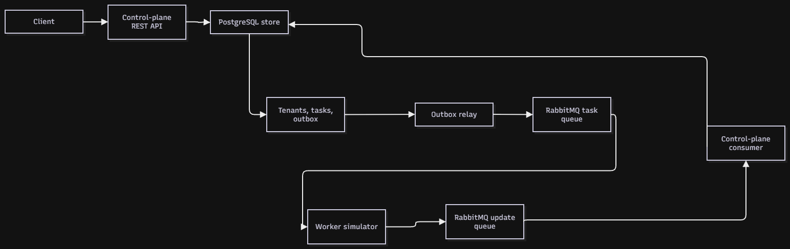

# tenant-control-plane

## Introduction

I built this project to explore how tenant provisioning can be handled reliably when the work happens asynchronously. The API records each tenant operation in PostgreSQL and uses a transactional outbox to send tasks to RabbitMQ, while a separate worker simulates provisioning and reports progress. I focused on keeping state transitions and concurrent updates safe and on making worker updates idempotent and tolerant of out-of-order delivery.

## Architecture



## Run locally

Clone the public repository:

```bash
git clone https://github.com/sagar-shaw-bits/tenant-control-plane.git
cd tenant-control-plane
```

Docker Compose starts PostgreSQL, RabbitMQ, the API, and worker. Postgres data is
kept in a named volume. The credentials supplied in Compose and `.env.example`
are local-development-only defaults; replace them outside local development.

```powershell
docker compose up --build
```

In another terminal, wait until the API is ready and create a tenant:

```powershell
curl http://localhost:8080/readyz
curl -X POST http://localhost:8080/v1/tenants \
  -H "Content-Type: application/json" \
  -d '{"slug":"tenant-1","name":"Tenant 1"}'
curl http://localhost:8080/v1/tenants
```

The worker should move the tenant from `provisioning` to `active` automatically.
Stop the stack with `Ctrl+C`, or run `docker compose down`; the named database
volume is retained. `docker compose down -v` removes that persisted data.

The database, broker, and API are exposed on ports 5432, 5672/15672, and 8080
by default. Set `HTTP_PORT`, `POSTGRES_PORT`, `RABBITMQ_PORT`, or
`RABBITMQ_MANAGEMENT_PORT` before invoking Compose to change host ports.

The test and check scripts require Go 1.27.3 or newer and Bash. The test
script also requires Docker with its daemon running; it starts temporary
PostgreSQL and RabbitMQ containers for integration tests.

Run the test suite:

```bash
./scripts/test.sh
```

Run formatting, lint, vulnerability, and test checks with:

```bash
./scripts/check.sh
```

The check script requires `goimports`, `golangci-lint`, and `govulncheck`.
Install the Go tools with:

```bash
go install golang.org/x/tools/cmd/goimports@latest
go install github.com/golangci/golangci-lint/v2/cmd/golangci-lint@latest
go install golang.org/x/vuln/cmd/govulncheck@latest
```

## HTTP API

The REST handlers use `/v1` and return JSON. Tenant create, update, and delete
responses include both the tenant and its asynchronous task:

```json
{"tenant":{"id":"...","status":"provisioning","version":1},"task":{"id":"...","type":"deploy","status":"accepted"}}
```

| Method | Path | Purpose | Success |
|---|---|---|---|
| `POST` | `/v1/tenants` | Create a tenant with `{ "slug": "...", "name": "..." }` | `201` |
| `GET` | `/v1/tenants?status=&limit=&cursor=` | List tenants using keyset pagination | `200` |
| `GET` | `/v1/tenants/:id` | Get a tenant | `200` |
| `PATCH` | `/v1/tenants/:id` | Update `{ "name": "...", "version": 1 }` | `202` |
| `DELETE` | `/v1/tenants/:id` | Request tenant destruction | `202` |
| `GET` | `/v1/tenants/:id/tasks?limit=&cursor=` | List tasks for a tenant | `200` |
| `GET` | `/v1/tasks?tenant_id=&status=&limit=&cursor=` | List tasks | `200` |
| `GET` | `/v1/tasks/:id` | Get a task | `200` |
| `GET` | `/healthz` | Liveness check | `200` |
| `GET` | `/readyz` | Dependency readiness check | `200` or `503` |

Errors use a structured body:

```json
{"error":{"code":"tenant_not_found","message":"tenant was not found","details":{}}}
```

| Error code | HTTP status |
|---|---:|
| `tenant_not_found`, `task_not_found` | `404` |
| `tenant_already_exists`, `tenant_update_not_allowed`, `tenant_version_conflict` | `409` |
| `validation_error` | `400` (request body over limit: `413`) |
| `internal_error` | `500` |

Example requests for every API route:

```powershell
# Create
curl.exe -X POST http://localhost:8080/v1/tenants -H "Content-Type: application/json" -d '{"slug":"example-tenant","name":"Example tenant"}'

# List tenants, optionally filtered and paginated
curl.exe "http://localhost:8080/v1/tenants?status=active&limit=50"

# Get tenant detail; use the ID returned by create/list
$tenantId = "<tenant-uuid>"
curl.exe "http://localhost:8080/v1/tenants/$tenantId"

# Update name with the currently returned version
curl.exe -X PATCH "http://localhost:8080/v1/tenants/$tenantId" -H "Content-Type: application/json" -d '{"name":"Renamed tenant","version":1}'

# Request delete
curl.exe -X DELETE "http://localhost:8080/v1/tenants/$tenantId"

# List this tenant's tasks
curl.exe "http://localhost:8080/v1/tenants/$tenantId/tasks"

# List tasks, optionally filtered by tenant and status
curl.exe "http://localhost:8080/v1/tasks?tenant_id=$tenantId&status=done"

# Get task detail; use the task ID returned by a mutation
$taskId = "<task-uuid>"
curl.exe "http://localhost:8080/v1/tasks/$taskId"

# Liveness and readiness
curl.exe http://localhost:8080/healthz
curl.exe http://localhost:8080/readyz
```

## Messaging delivery

Tenant/task mutations persist their outbound event in the same PostgreSQL
transaction as the state change. The outbox relay publishes persistent task
events to RabbitMQ and marks them published only after a publisher confirmation.
If publication succeeds but the database transaction cannot commit, the event
may be delivered again; consumers must therefore be idempotent.

The broker declares durable task and worker-update queues, persistent
publications, publisher confirms, and a dead-letter queue for rejected worker
updates. Broker connectivity is retried when establishing a connection and
re-established on the next publish after a disconnect.

Worker updates are applied transactionally with an idempotency key before
manual acknowledgement. Malformed updates and updates for unknown tasks are
rejected to the dead-letter queue. Transient database failures receive up to
five retries with exponential backoff and jitter, then are dead-lettered.
Stale state transitions for terminal tasks are ignored and acknowledged. If a
terminal result arrives before `in_progress`, it is persisted and applied once
the progress update arrives.

## Design decisions and limitations

- **Transactional outbox:** the database mutation and event persist atomically;
  RabbitMQ publication occurs after commit. This avoids publishing rolled-back
  work while accepting at-least-once delivery if the relay publishes and its
  database commit subsequently fails.
- **Optimistic locking:** PATCH uses a single conditional update on the tenant
  ID, active status, and supplied version. Concurrent requests with the same
  version cannot both move the tenant into `updating`.
- **Partial unique index:** application state guards prevent starting a second
  task, and PostgreSQL independently enforces one open task per tenant.
- **Idempotent updates:** worker update IDs are persisted in the same
  transaction as task and tenant changes. Duplicate deliveries therefore do
  not apply a second mutation.
- **RabbitMQ:** durable queues, persistent messages, manual acknowledgments,
  publisher confirms, and a dead-letter queue support asynchronous task
  delivery and recovery from process restarts.
- **Gin and use-case stores:** Gin is limited to REST adapters and middleware.
  Services use narrow use-case interfaces; the PostgreSQL implementation owns
  transactions that preserve tenant/task/outbox consistency.
- **Known limitations:** authentication, metrics, tracing, and a timeout/reaper
  are outside the current scope. An update that never arrives cannot be inferred
  or recovered without a timeout/reaper.

The worker simulator is `cmd/worker`. It accepts both environment variables
and flags: `FAIL_RATE` / `--fail-rate`, `MIN_DELAY_MS` / `--min-delay-ms`,
`MAX_DELAY_MS` / `--max-delay-ms`, `DUPLICATE_RATE` / `--duplicate-rate`, and
`OUT_OF_ORDER` / `--out-of-order`. For example:

```powershell
$env:FAIL_RATE = "1"
go run ./cmd/worker --min-delay-ms=100 --max-delay-ms=250
```

`--out-of-order` sends a terminal result before `in_progress`; the control plane
persists that result and applies it once the progress update arrives.

For reproducible negative scenarios, set the worker environment and recreate
only that service:

```powershell
$env:FAIL_RATE = "1"
docker compose up -d --build --no-deps worker
```

To publish worker updates manually, run
`./scripts/publish-update.sh TASK_ID done [UPDATE_ID]`. Reuse the
same optional `UPDATE_ID` to test duplicate delivery. `./scripts/race.sh`
creates 20 concurrent same-version PATCHes and 20 same-slug tenant creates;
expected success count for each group is exactly one. Both scripts require
Bash, `curl`, and Python 3; `race.sh` also requires the API and worker stack to
be running with the default successful worker configuration.
